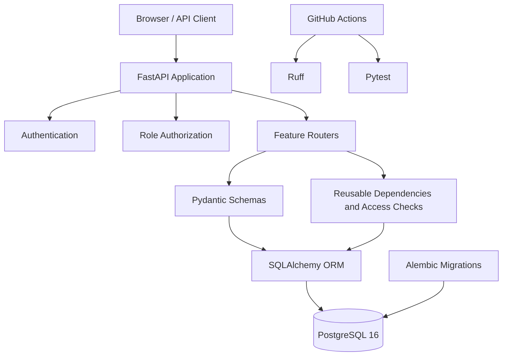
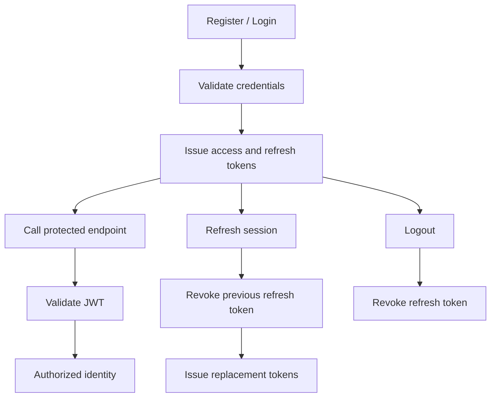
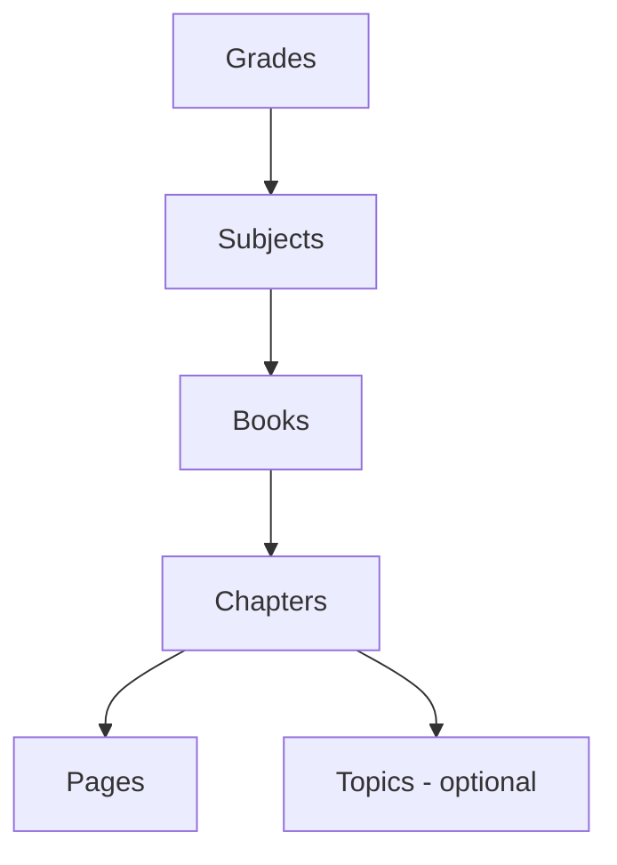
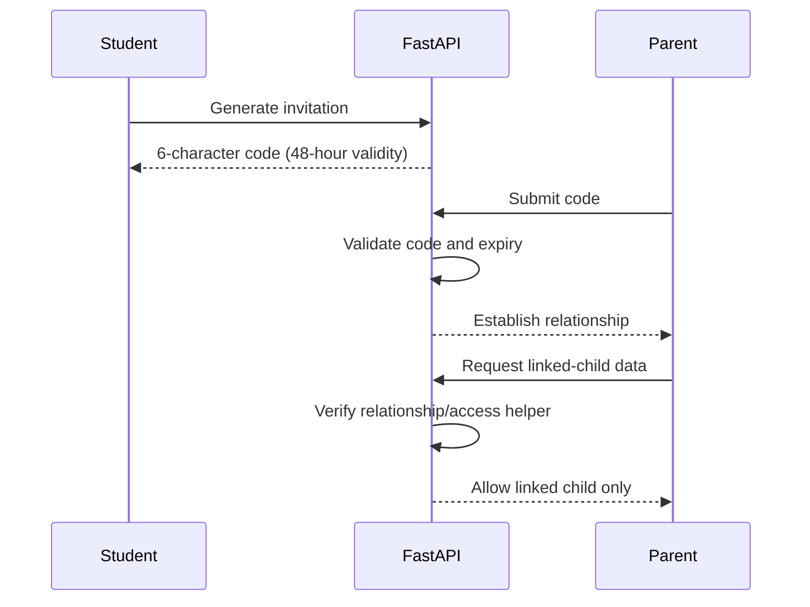
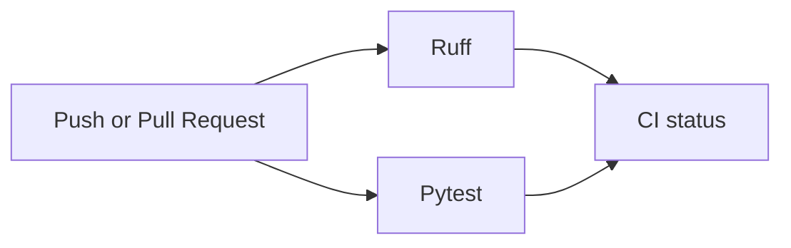
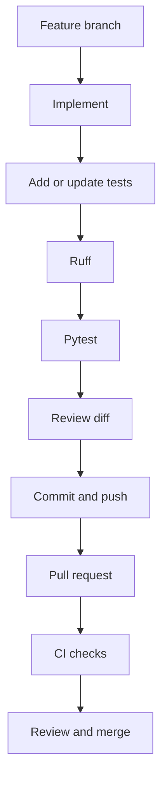

# Backend API — Secure REST API & Curriculum Management

<div align="center">

### A containerized backend built with FastAPI, PostgreSQL, SQLAlchemy, and Docker

[](https://www.python.org/)
[](https://fastapi.tiangolo.com/)
[](https://www.postgresql.org/)
[](https://www.docker.com/)
[](https://www.sqlalchemy.org/)
[](https://github.com/AMAN-AJWA-FATIMA/Backend/actions/workflows/ci.yml)
[](https://github.com/AMAN-AJWA-FATIMA/Backend)

**[Swagger UI](http://localhost:8000/docs)** · **[ReDoc](http://localhost:8000/redoc)** · **[Web App](http://localhost:8000/)**

</div>

---

## Overview

A containerized REST API built with Python and FastAPI, featuring secure authentication, role-based authorization, task management, curriculum management, student and parent profiles, parent–child linking, and consent records. It uses PostgreSQL, SQLAlchemy, Alembic, automated tests, GitHub Actions, and a browser interface for interacting with application workflows.

## Interactive Navigation

<details open>
<summary><strong>Contents (expand/collapse)</strong></summary>

- [Architecture](#architecture)
- [Technology Stack](#technology-stack)
- [Project Structure](#project-structure)
- [Features](#features)
  - [Authentication](#authentication)
  - [Authorization](#role-based-authorization)
  - [Users and Tasks](#user-management-and-task-management)
  - [Curriculum](#curriculum-management)
  - [Family Profiles](#family-profiles--parent-child-linking)
  - [Frontend](#frontend)
- [API Reference](#api-reference)
- [Database](#database-design)
- [Quick Start](#quick-start)
- [Migrations and Seed Data](#database-migrations-and-seed-data)
- [Admin Provisioning](#administrator-provisioning)
- [Testing and CI](#testing)
- [Security](#security)
- [Known Limitations](#known-limitations)
- [Development Workflow](#development-workflow)

</details>

---

## Architecture



### Request lifecycle

1. Client sends an HTTP request.
2. FastAPI routes the request.
3. Pydantic validates input.
4. Authentication dependencies verify identity where required.
5. Role/resource access checks authorize the operation.
6. SQLAlchemy interacts with PostgreSQL.
7. The API returns a structured response.

<details>
<summary><strong>Application layers</strong></summary>

| Layer | Responsibility |
|---|---|
| `core/` | Configuration, database, security utilities |
| `dependencies/` | Authentication, authorization, reusable access checks |
| `models/` | SQLAlchemy models |
| `schemas/` | Pydantic request/response schemas |
| `routers/` | API endpoints and feature operations |
| `scripts/` | Admin and seed utilities |
| `tests/` | Automated tests |
| `alembic/` | Database schema versioning |
| `.github/workflows/` | CI workflow |
| `web/` | Browser interface |

</details>

## Technology Stack

| Technology | Purpose |
|---|---|
| Python 3.12 | Backend language |
| FastAPI | REST API framework |
| Pydantic | Input validation and serialization |
| SQLAlchemy 2 | ORM and database access |
| PostgreSQL 16 | Relational database |
| Alembic | Database migrations |
| Argon2id | Password hashing |
| PyJWT | JWT authentication |
| Docker / Compose | Containerization and orchestration |
| Pytest / HTTPX | Automated API testing |
| Ruff | Linting and code quality |
| Git / GitHub | Version control |
| GitHub Actions | Continuous integration |
| DBeaver | Database administration |
| HTML / CSS / JavaScript | Frontend |

## Project Structure

<details>
<summary><strong>Expand repository tree</strong></summary>

```text
Backend/
├── .github/workflows/ci.yml
├── alembic/
│   ├── versions/
│   │   ├── 20261113_01_authentication.py
│   │   ├── 20261120_01_curriculum.py
│   │   └── 20261127_01_family_profiles.py
│   ├── env.py
│   └── script.py.mako
├── app/
│   ├── core/                 # configuration, database, security
│   ├── dependencies/         # authentication, permissions, family access
│   ├── models/               # user, refresh token, curriculum, family
│   ├── routers/               # auth, users, tasks, curriculum, family
│   ├── schemas/               # validation and response schemas
│   └── main.py
├── scripts/
│   ├── create_admin.py
│   └── seed_curriculum.py
├── tests/
│   ├── conftest.py
│   ├── test_auth.py
│   ├── test_curriculum.py
│   ├── test_family.py
│   ├── test_healthy.py
│   ├── test_tasks.py
│   └── test_users.py
├── web/index.html
├── .env.example
├── .gitignore
├── alembic.ini
├── Dockerfile
├── docker-compose.yml
├── pyproject.toml
├── requirements.txt
└── README.md
```

> This tree is a structural summary. Verify filenames against the current checkout if modules have been renamed or split.

</details>


# Features

## Authentication

- Registration and login using email/password
- Argon2id password hashing
- JWT access-token issuance
- Refresh-token rotation
- Refresh-token revocation on logout
- Authenticated profile endpoint
- Bearer-token authentication

### Token settings

| Token | Configuration |
|---|---|
| Access token | JWT, HS256 |
| Access lifetime | 15 minutes |
| Refresh token | Cryptographically random opaque token |
| Refresh lifetime | 14 days |
| Refresh-token storage | SHA-256 digest |
| Rotation | Enabled |
| Revocation | Supported |

<details>
<summary><strong>Authentication flow</strong></summary>



</details>

## Role-Based Authorization

| Role | Responsibility |
|---|---|
| `student` | Student account and learning workflows |
| `parent` | Parent account and linked-child workflows |
| `admin` | Administrative operations |

A reusable role dependency protects restricted endpoints. Public registration is restricted to permitted roles; admin accounts are provisioned separately.

| Area | Access rule |
|---|---|
| Current-account profile | Authenticated user |
| Admin operations | Admin only |
| Parent family workflows | Parent role plus applicable relationship checks |
| Student profile workflows | Student role |
| Public curriculum reads | Public, published content only |
| Curriculum administration | Admin only |

## User Management and Task Management

### User management

User operations include retrieval/listing workflows, validation, role controls, and pagination where supported. Check Swagger for the exact endpoint methods and schemas.

### Tasks

Task operations include creating, retrieving, updating, deleting, listing, filtering, and pagination, with request validation and error handling.

## Curriculum Management



| Entity | Description |
|---|---|
| Grade | Educational grade level |
| Subject | Subject assigned to a grade |
| Book | Book associated with a subject |
| Chapter | Chapter in a book |
| Page | Page content, number, and media reference |
| Topic | Optional chapter tag |

### Publishing and access

- Books have a publishing state.
- Public read endpoints expose published books.
- Unpublished content is restricted from public access.
- Curriculum administration requires the admin role.

### Admin curriculum operations

Create, update, and delete curriculum resources where supported: grades, subjects, books, chapters, pages, and topics. Consult Swagger for the exact resource paths, methods, and payloads.

### Seed dataset

| Data | Count |
|---|---:|
| Grades | 2 |
| Subjects | 3 |
| Books | 2 |
| Chapters | 10 |
| Chapters per book | 5 |

## Family Profiles & Parent–Child Linking

The family module implements profile management, invitation-based parent linking, parent-child access checks, and consent recording.

### Profiles

| Profile | Field | Notes |
|---|---|---|
| Student | Name | Profile name |
| Student | Grade | Grade association |
| Student | School | Optional |
| Student | Exam date | Profile field |
| Student | Date of birth | Used for age/consent workflow |
| Student | Preferred language | English or Urdu |
| Parent | Name | Profile name |
| Parent | Phone | Optional |

### Link workflow



### Linking and consent rules

- Student creates a six-character invite code valid for 48 hours.
- Expired codes are rejected.
- Parent submits a valid code to link with a student.
- One parent may link multiple children.
- Parent access to child data is limited to linked children.
- A reusable family-access helper is available for enforcing relationship checks in protected endpoints.
- Parental consent information, including its date, is persisted for students under 18.

<details>
<summary><strong>Family acceptance checks</strong></summary>

| Acceptance criterion | Reported status |
|---|---|
| Parent cannot read unlinked student's data | Implemented and covered by family tests |
| Expired invitation rejected | Implemented and covered by family tests |
| Consent date saved | Implemented in persistence workflow |
| Parent can link multiple children | Supported |
| Profiles implemented | Student and parent profiles implemented |
| Migration and tests | Added and applied/validated |

</details>

## Frontend

The web interface is served by the application and lives in `web/index.html`.

### UI modules

- Registration, login, refresh, logout, current account
- Role-aware views and workflows
- Student profile creation/editing
- Parent profile creation/editing
- Invitation-code generation and entry
- Parent-child linking and linked-child view
- Consent submission interface
- Curriculum browsing
- Task workflows
- Administrative interface for supported operations
- Responsive layout and theme controls

> **Integration status:** Frontend workflows are implemented in the updated interface but require a live end-to-end verification pass against the API. UI availability is not itself proof that each request/response flow has been tested.

# API Reference

FastAPI provides generated interactive documentation:

| Docs | URL |
|---|---|
| Swagger UI | [http://localhost:8000/docs](http://localhost:8000/docs) |
| ReDoc | [http://localhost:8000/redoc](http://localhost:8000/redoc) |
| OpenAPI JSON | [http://localhost:8000/openapi.json](http://localhost:8000/openapi.json) |

## General endpoints

| Method | Endpoint | Description |
|---|---|---|
| GET | `/` | Web UI |
| GET | `/health` | Health check |

## Authentication endpoints

| Method | Endpoint | Description | Access |
|---|---|---|---|
| POST | `/auth/register` | Register permitted user | Public |
| POST | `/auth/login` | Authenticate and issue tokens | Public |
| POST | `/auth/refresh` | Rotate refresh token | Refresh token |
| POST | `/auth/logout` | Revoke refresh token | Refresh token |
| GET | `/auth/me` | Current account profile | Bearer token |

## Authorization demo

| Method | Endpoint | Allowed role(s) |
|---|---|---|
| GET | `/admin/dashboard` | Admin |
| GET | `/parent/dashboard` | Parent, Admin |

## User and task routes

| Endpoint | Description |
|---|---|
| `/users` | User operations/listing |
| `/users/{user_id}` | Individual user operations |
| `/tasks` | Task creation/listing, filtering, pagination |
| `/tasks/{task_id}` | Individual task retrieval/update/deletion |

See Swagger for exact methods and schemas.

## Curriculum routes

### Public reads

| Method | Endpoint | Description |
|---|---|---|
| GET | `/curriculum/grades` | List grades |
| GET | `/curriculum/grades/{grade_id}/subjects` | List subjects for grade |
| GET | `/curriculum/subjects/{subject_id}/books` | List published books |
| GET | `/curriculum/books/{book_id}/chapters` | List chapters in published book |
| GET | `/curriculum/chapters/{chapter_id}/pages` | List pages for published chapter |

### Admin

Admin curriculum operations are grouped under `/curriculum/admin/`. They require the admin role; use Swagger to confirm resource names, methods, and payload schemas.

## Family routes

Family router operations include profile creation/update, invitation-code creation, code-based linking, linked-child retrieval, protected child-data access, and consent recording. Consult Swagger for the current exact route names, methods, and request/response models.

## Pagination

Curriculum listing endpoints support pagination:

| Parameter | Type | Default | Constraints |
|---|---|---:|---|
| `page` | Integer | 1 | Minimum 1 |
| `page_size` | Integer | 20 | 1–100 |

Example:

```http
GET /curriculum/grades?page=1&page_size=20
```

Typical pagination structure:

```json
{
  "items": [],
  "total": 0,
  "page": 1,
  "page_size": 20,
  "pages": 0
}
```

# Database Design

The project uses PostgreSQL 16 with SQLAlchemy 2.

<details>
<summary><strong>Core data domains</strong></summary>

| Domain | Data represented |
|---|---|
| Accounts | User accounts, roles, credentials |
| Authentication | Refresh-token digests, expiry, revocation |
| Tasks | Task records |
| Curriculum | Grades, subjects, books, chapters, pages, topics |
| Family | Student/parent profiles, invitation/link records, parent-child relations, consent |

</details>

Curriculum schema uses UUID identifiers, timestamps, foreign keys, and uniqueness/integrity constraints where defined. Family migration adds persistence for profiles, linking, and consent.

# Quick Start

### Prerequisites

- Python 3.12
- Git
- Docker Engine
- Docker Compose

<details>
<summary><strong>1. Clone repository</strong></summary>

```bash
git clone https://github.com/AMAN-AJWA-FATIMA/Backend.git
cd Backend
```
</details>

<details>
<summary><strong>2. Configure environment</strong></summary>

```bash
cp .env.example .env
nano .env
```

Use `.env.example` and the application's settings module to determine the exact environment variable names. Example placeholder values:

```dotenv
POSTGRES_USER=postgres
POSTGRES_PASSWORD=replace_with_a_strong_local_password
POSTGRES_DB=task_management_db

DB_HOST=db
DB_PORT=5432
DB_NAME=task_management_db
DB_USER=task_management_app
DB_PASSWORD=replace_with_a_strong_local_password

JWT_SECRET_KEY=replace_with_a_long_random_secret
ACCESS_TOKEN_EXPIRE_MINUTES=15
REFRESH_TOKEN_EXPIRE_DAYS=14
```

> Never commit `.env`, real credentials, or production secrets. Verify these names against the actual configuration before use.
</details>


<details>
<summary><strong>3. Build and start containers</strong></summary>

```bash
docker compose up --build
```

Or detached:

```bash
docker compose up -d --build
```
</details>

<details>
<summary><strong>4. Check containers</strong></summary>

```bash
docker compose ps
```
</details>

<details>
<summary><strong>5. Check API health</strong></summary>

```bash
curl -i http://localhost:8000/health
```

Expected response:

```json
{
  "status": "healthy"
}
```
</details>

<details>
<summary><strong>6. Open app and docs</strong></summary>

- Web UI: [http://localhost:8000/](http://localhost:8000/)
- Swagger: [http://localhost:8000/docs](http://localhost:8000/docs)
- ReDoc: [http://localhost:8000/redoc](http://localhost:8000/redoc)
</details>

### Compose services

| Service | Container | Port mapping (reported setup) |
|---|---|---|
| API | `backend_api` | `8000` |
| PostgreSQL | `backend_db` | Host `5433` → container `5432` |

> Confirm service/container names and ports against the current `docker-compose.yml`.

# Database Migrations and Seed Data

<details>
<summary><strong>Alembic migration commands</strong></summary>

```bash
alembic upgrade head
alembic current
alembic history
```

</details>

The API container startup is configured to apply migrations before application startup, as implemented in the project.

<details>
<summary><strong>Seed curriculum data</strong></summary>

```bash
docker compose exec api python -m scripts.seed_curriculum
```

Expected sample hierarchy: 2 grades, 3 subjects, 2 books, and 10 chapters (5 per book). Confirm the Compose service name `api` before running.

</details>

# Administrator Provisioning

Admin accounts are provisioned outside public registration. The repository utility is:

```bash
docker compose exec api python -m scripts.create_admin
```

The utility is intended to collect admin information and credentials, validate them, hash the password, and create an admin account. Verify the current script and service name before execution.

# Testing

<details>
<summary><strong>Run the test suite</strong></summary>

```bash
pytest -v
# or
pytest -q
```

</details>

<details>
<summary><strong>Run individual test modules</strong></summary>

```bash
pytest tests/test_auth.py -v
pytest tests/test_tasks.py -v
pytest tests/test_users.py -v
pytest tests/test_curriculum.py -v
pytest tests/test_family.py -v
```

</details>

<details>
<summary><strong>Test coverage areas</strong></summary>

**Authentication:** registration/login, invalid credentials, authenticated profile, token validation/expiry, refresh rotation/reuse rejection, logout, role checks, registration role restrictions.

**Users and tasks:** retrieval, validation, duplicate handling, pagination, task CRUD, filters, missing/invalid records.

**Curriculum:** hierarchical reads, pagination, admin CRUD, role restrictions, validation, invalid relationships, unpublished-content restrictions.

**Family:** profile/linking workflow, invite expiry, parent-child access rules, consent workflow.

</details>

### Latest reported validation results

| Check | Result |
|---|---|
| Family tests | 5 passed |
| Full test suite | 52 passed |
| Ruff | Passed |
| Alembic | Applied; reported revision `20261127_01` |
| Docker Compose | Verified in prior task validation |

> These are the latest reported results in project context. Re-run checks on the current branch to refresh the evidence after changes.

# Continuous Integration

GitHub Actions workflow: `.github/workflows/ci.yml`



| CI check | Purpose |
|---|---|
| Ruff | Linting and code-quality checks |
| Pytest | Automated test suite |

Run checks locally:

```bash
ruff check .
pytest -v
docker compose config -q
```

[View GitHub Actions runs](https://github.com/AMAN-AJWA-FATIMA/Backend/actions)

# Security

- Argon2id password hashing
- JWT signature and expiry validation
- Short-lived access tokens
- Refresh-token rotation and revocation
- Digest-based refresh-token storage
- Role-based authorization
- Restricted admin operations
- Pydantic validation
- Environment-configured secrets
- Public registration role restrictions
- Parent-child relationship checks for protected child-data access

# Known Limitations

- Access JWTs remain valid until expiration after logout; immediate access-token revocation is not implemented.
- Email verification is not implemented.
- Password-reset workflow is not implemented.
- Rate limiting is not currently implemented.
- Frontend workflows still need a live end-to-end verification pass against the backend API.
- CI runs linting and tests; it does not necessarily build and exercise the complete Docker stack.
- Confirm exact environment variable names, service names, and endpoint schemas against the current source before using example commands.

# Development Workflow



<details>
<summary><strong>Suggested workflow commands</strong></summary>

```bash
git switch -c feature/your-feature
# implement changes and add tests
ruff check .
pytest -v
git diff
git diff --check
git add .
git commit -m "feat: describe your feature"
git push -u origin feature/your-feature
```

Open a pull request to `main`, review the changes, and merge after checks pass.

</details>

---

## Repository

**GitHub:** [AMAN-AJWA-FATIMA/Backend](https://github.com/AMAN-AJWA-FATIMA/Backend)

<div align="center">


</div>
