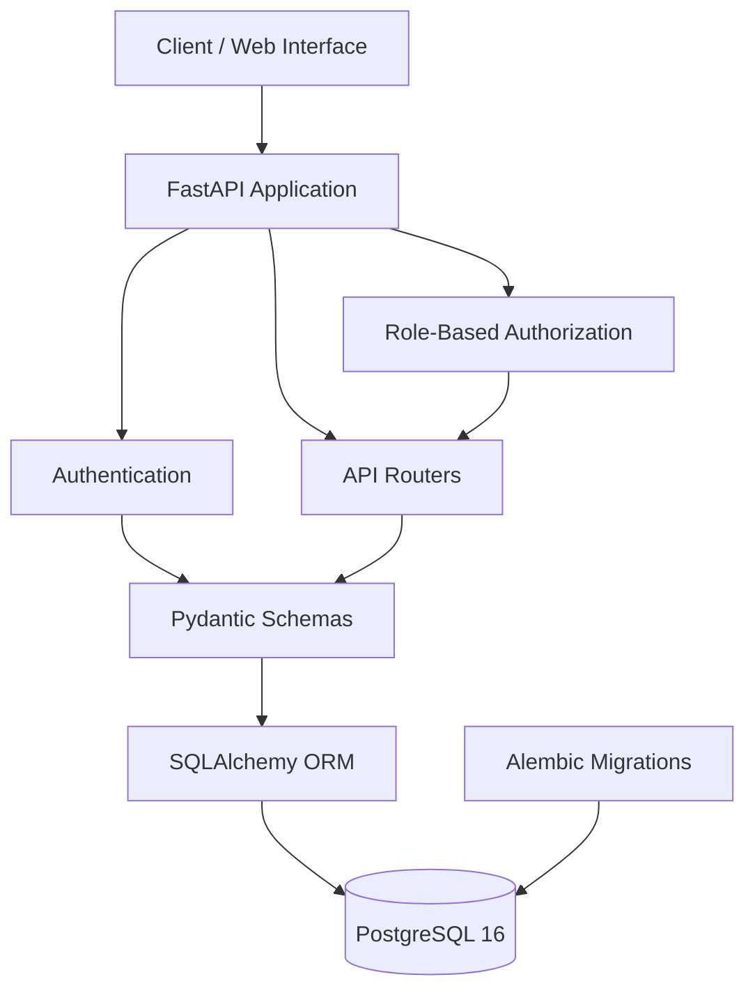
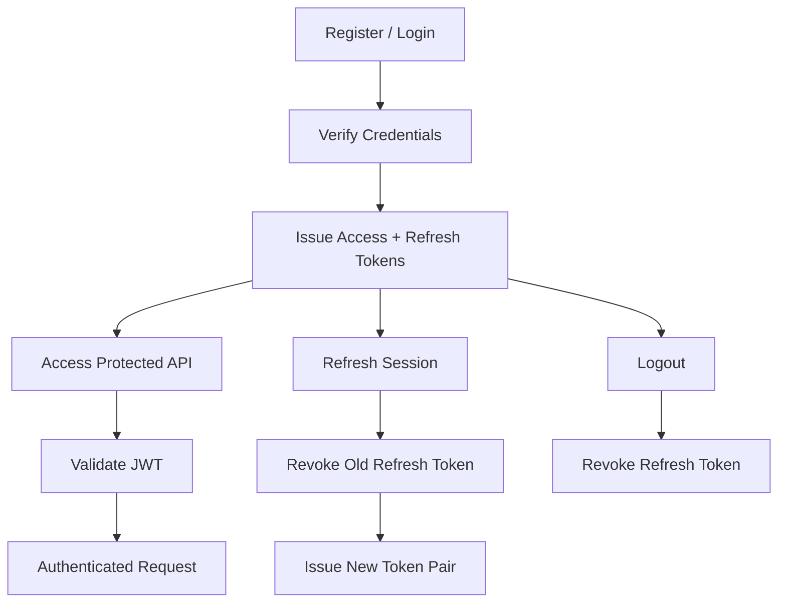
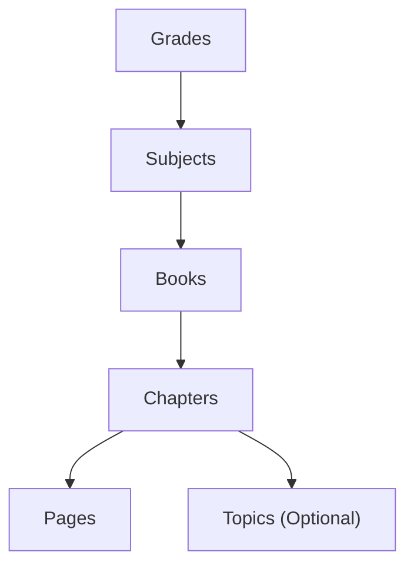
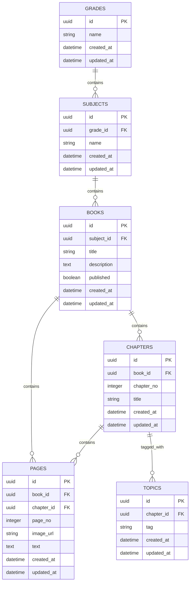
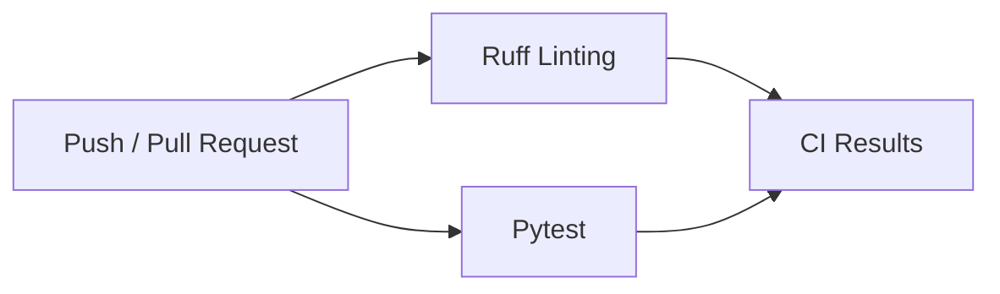
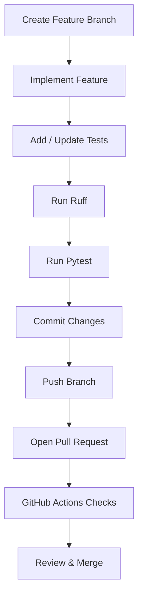

# Backend API — Secure REST API & Curriculum Management

<div align="center">

### A containerized backend built with FastAPI, PostgreSQL, SQLAlchemy, and Docker

[](https://www.python.org/)
[](https://fastapi.tiangolo.com/)
[](https://www.postgresql.org/)
[](https://www.docker.com/)
[](https://www.sqlalchemy.org/)
[](https://github.com/AMAN-AJWA-FATIMA/Backend/actions/workflows/ci.yml)
[](https://github.com/AMAN-AJWA-FATIMA/Backend)

**[Repository](https://github.com/AMAN-AJWA-FATIMA/Backend)** · **[Swagger UI](http://localhost:8000/docs)** · **[ReDoc](http://localhost:8000/redoc)**

</div>

---

## Overview

A containerized REST API project demonstrating backend development fundamentals and production-oriented practices using Python.

The application includes user and task management, secure authentication, role-based authorization, and a curriculum management system backed by PostgreSQL.

### Highlights

- 🔐 Secure authentication with JWT access tokens and rotating refresh tokens
- 🛡️ Role-based authorization for student, parent, and admin users
- 👥 User management with validation and pagination
- 📋 Task management with CRUD operations, filters, and pagination
- 📚 Curriculum hierarchy: grades, subjects, books, chapters, pages, and topics
- 📖 Public access restricted to published books
- 🗄️ PostgreSQL database with SQLAlchemy ORM
- 🔄 Database versioning with Alembic
- 🐳 Containerized services with Docker Compose
- 🧪 Automated API tests with Pytest and HTTPX
- ⚙️ CI pipeline with GitHub Actions and Ruff

---

## Table of Contents

<details open>
<summary><strong>Click to expand navigation</strong></summary>

- [Architecture](#architecture)
- [Technology Stack](#technology-stack)
- [Project Structure](#project-structure)
- [Features](#features)
  - [Authentication](#authentication)
  - [Role-Based Authorization](#role-based-authorization)
  - [Task Management](#task-management)
  - [Curriculum Management](#curriculum-management)
- [API Reference](#api-reference)
- [Database Design](#database-design)
- [Quick Start](#quick-start)
- [Database Migrations](#database-migrations)
- [Seed Data](#seed-data)
- [Testing](#testing)
- [Continuous Integration](#continuous-integration)
- [Security](#security)
- [Known Limitations](#known-limitations)
- [Development Workflow](#development-workflow)

</details>

---

## Architecture



### Request lifecycle

1. A client sends an HTTP request.
2. FastAPI routes the request to the appropriate endpoint.
3. Pydantic validates incoming data.
4. Authentication dependencies verify identity when required.
5. Authorization dependencies enforce role permissions.
6. SQLAlchemy interacts with PostgreSQL.
7. The API returns a structured response.

---

## Technology Stack

| Technology | Purpose |
|---|---|
| Python 3.12 | Backend programming language |
| FastAPI | REST API framework |
| Pydantic | Request validation and serialization |
| SQLAlchemy 2 | ORM and database access |
| PostgreSQL 16 | Relational database |
| Alembic | Database migrations |
| Argon2id | Password hashing |
| PyJWT | JWT authentication |
| Docker | Containerization |
| Docker Compose | Service orchestration |
| Pytest | Automated testing |
| HTTPX | API testing |
| Ruff | Linting and code quality |
| Git & GitHub | Version control |
| GitHub Actions | Continuous integration |
| DBeaver | Database administration |

---

## Project Structure

```text
Backend/
├── .github/
│   └── workflows/
│       └── ci.yml
│
├── alembic/
│   ├── versions/
│   │   ├── 20261113_01_authentication.py
│   │   └── 20261120_01_curriculum.py
│   ├── env.py
│   └── script.py.mako
│
├── app/
│   ├── core/
│   │   ├── config.py
│   │   ├── database.py
│   │   └── security.py
│   │
│   ├── dependencies/
│   │   ├── authentication.py
│   │   └── permissions.py
│   │
│   ├── models/
│   │   ├── user.py
│   │   ├── refresh_token.py
│   │   └── curriculum.py
│   │
│   ├── routers/
│   │   ├── auth.py
│   │   ├── authorization_demo.py
│   │   ├── users.py
│   │   ├── tasks.py
│   │   └── curriculum.py
│   │
│   ├── schemas/
│   │   ├── auth.py
│   │   ├── user.py
│   │   ├── task.py
│   │   └── curriculum.py
│   │
│   └── main.py
│
├── scripts/
│   ├── create_admin.py
│   └── seed_curriculum.py
│
├── tests/
│   ├── conftest.py
│   ├── test_auth.py
│   ├── test_curriculum.py
│   ├── test_healthy.py
│   ├── test_tasks.py
│   └── test_users.py
│
├── web/
│   └── index.html
│
├── .env.example
├── .gitignore
├── alembic.ini
├── Dockerfile
├── docker-compose.yml
├── pyproject.toml
├── requirements.txt
└── README.md
```

<details>
<summary><strong>Explore the application layers</strong></summary>

| Layer | Responsibility |
|---|---|
| `core/` | Configuration, database connection, security utilities |
| `dependencies/` | Authentication and authorization dependencies |
| `models/` | SQLAlchemy database models |
| `schemas/` | Pydantic request and response schemas |
| `routers/` | HTTP endpoints and application logic |
| `scripts/` | Administrative and data-seeding utilities |
| `tests/` | Automated application tests |
| `alembic/` | Database schema versioning |
| `.github/workflows/` | Automated CI pipeline |

</details>

---

# Features

## Authentication

The authentication system supports:

- User registration
- Login using email and password
- Secure password hashing using Argon2id
- JWT access-token issuance
- Refresh-token rotation
- Logout and refresh-token revocation
- Authenticated profile retrieval
- Bearer-token authentication

### Authentication lifecycle



### Token configuration

| Token | Configuration |
|---|---|
| Access token | JWT |
| Signing algorithm | HS256 |
| Access lifetime | 15 minutes |
| Refresh token | Cryptographically random opaque token |
| Refresh lifetime | 14 days |
| Refresh-token storage | SHA-256 digest |
| Rotation | Enabled |
| Revocation | Supported |

---

## Role-Based Authorization

The application supports three roles:

| Role | Description |
|---|---|
| `student` | Standard student account |
| `parent` | Parent account |
| `admin` | Administrative account |

A reusable `require_roles()` dependency controls access to protected endpoints.

### Authorization examples

| Endpoint | Allowed roles |
|---|---|
| `/admin/dashboard` | Admin |
| `/parent/dashboard` | Parent, Admin |
| `/auth/me` | Authenticated users |
| Curriculum administration | Admin |
| Public curriculum reads | Public |

Public registration supports student and parent roles. Administrator accounts are provisioned separately.

---

## Task Management

The task-management API provides:

- Task creation
- Task retrieval
- Task updates
- Task deletion
- Task listing
- Filtering
- Pagination
- Database relationship handling
- Request validation
- Error handling for nonexistent records

---

## Curriculum Management

The curriculum module provides a hierarchical educational-content API.

### Curriculum hierarchy



### Curriculum entities

| Entity | Description |
|---|---|
| Grade | Educational grade level |
| Subject | Subject associated with a grade |
| Book | Educational book associated with a subject |
| Chapter | Chapter belonging to a book |
| Page | Page content, image URL, and page number |
| Topic | Optional chapter tag |

### Publishing rules

- Books have a `published` flag.
- Public book listings only return published books.
- Unpublished books are not accessible through public chapter or page endpoints.
- Curriculum administration is restricted to admin users.

### Curriculum CRUD operations

Administrators can create, update, and delete:

- Grades
- Subjects
- Books
- Chapters
- Pages
- Topics

### Seed dataset

The seed script provides:

| Data | Quantity |
|---|---:|
| Grades | 2 |
| Subjects | 3 |
| Books | 2 |
| Chapters | 10 |
| Chapters per book | 5 |

---

# API Reference

Interactive API documentation is generated automatically by FastAPI.

| Documentation | URL |
|---|---|
| Swagger UI | [http://localhost:8000/docs](http://localhost:8000/docs) |
| ReDoc | [http://localhost:8000/redoc](http://localhost:8000/redoc) |
| OpenAPI JSON | [http://localhost:8000/openapi.json](http://localhost:8000/openapi.json) |

---

## General Endpoints

| Method | Endpoint | Description |
|---|---|---|
| GET | `/` | Web interface |
| GET | `/health` | Health check |

## Authentication Endpoints

| Method | Endpoint | Description | Access |
|---|---|---|---|
| POST | `/auth/register` | Register a user | Public |
| POST | `/auth/login` | Authenticate and issue tokens | Public |
| POST | `/auth/refresh` | Rotate refresh token | Refresh token |
| POST | `/auth/logout` | Revoke refresh token | Refresh token |
| GET | `/auth/me` | Get current user profile | Bearer token |

## Authorization Demonstration

| Method | Endpoint | Allowed roles |
|---|---|---|
| GET | `/admin/dashboard` | Admin |
| GET | `/parent/dashboard` | Parent, Admin |

## User Endpoints

| Endpoint | Description |
|---|---|
| `/users` | User operations and listing |
| `/users/{user_id}` | Operations on an individual user |

Consult Swagger UI for the exact supported HTTP methods and schemas.

## Task Endpoints

| Endpoint | Description |
|---|---|
| `/tasks` | Task creation, listing, filtering, pagination |
| `/tasks/{task_id}` | Retrieve, update, or delete a task |

Consult Swagger UI for the exact request parameters and schemas.

## Curriculum Endpoints

### Public Read Endpoints

| Method | Endpoint | Description |
|---|---|---|
| GET | `/curriculum/grades` | List grades |
| GET | `/curriculum/grades/{grade_id}/subjects` | List subjects in a grade |
| GET | `/curriculum/subjects/{subject_id}/books` | List published books |
| GET | `/curriculum/books/{book_id}/chapters` | List chapters in a published book |
| GET | `/curriculum/chapters/{chapter_id}/pages` | List pages in a published chapter |

### Admin Endpoints

| Method | Endpoint | Description |
|---|---|---|
| POST | `/curriculum/admin/{resource}` | Create a resource |
| PATCH | `/curriculum/admin/{resource}/{record_id}` | Update a resource |
| DELETE | `/curriculum/admin/{resource}/{record_id}` | Delete a resource |

Supported resource names:

```text
grades
subjects
books
chapters
pages
topics
```

All curriculum administration endpoints require the `admin` role.

---

## Pagination

Public curriculum list endpoints support:

| Parameter | Type | Default | Constraints |
|---|---|---:|---|
| `page` | Integer | 1 | Minimum 1 |
| `page_size` | Integer | 20 | 1–100 |

### Example request

```http
GET /curriculum/grades?page=1&page_size=20
```

### Standard response structure

All paginated curriculum list endpoints use the same response format:

```json
{
  "items": [],
  "total": 0,
  "page": 1,
  "page_size": 20,
  "pages": 0
}
```

| Field | Description |
|---|---|
| `items` | Records returned for the current page |
| `total` | Total number of matching records |
| `page` | Current page |
| `page_size` | Maximum records per page |
| `pages` | Total number of pages |

---

# Database Design

The application uses PostgreSQL 16 and SQLAlchemy 2.

## Core tables

### Authentication and task management

| Table | Purpose |
|---|---|
| `users` | User accounts, roles, credentials |
| `refresh_tokens` | Refresh-token hashes, expiration, revocation |
| `tasks` | Task-management records |

### Curriculum

| Table | Purpose |
|---|---|
| `grades` | Grade levels |
| `subjects` | Subjects associated with grades |
| `books` | Books associated with subjects |
| `chapters` | Chapters associated with books |
| `pages` | Page content, page number, image URL |
| `topics` | Optional chapter tags |

## Curriculum relationships



### Database constraints and indexes

The curriculum module includes:

- UUID primary keys
- `created_at` and `updated_at` timestamps
- Foreign-key constraints
- Foreign-key indexes
- Unique grade names
- Unique subject names per grade
- Unique chapter numbers per book
- Unique page numbers per book
- Referential integrity for page/book/chapter relationships

---

# Quick Start

## Prerequisites

- Python 3.12
- Git
- Docker Engine
- Docker Compose

## 1. Clone the repository

```bash
git clone https://github.com/AMAN-AJWA-FATIMA/Backend.git
cd Backend
```

## 2. Configure environment variables

Create the environment file:

```bash
cp .env.example .env
```

Edit it:

```bash
nano .env
```

Configure the variables with appropriate local values:

```env
POSTGRES_USER=postgres
POSTGRES_PASSWORD=replace_with_a_strong_local_password
POSTGRES_DB=task_management_db

DB_HOST=localhost
DB_PORT=5433
DB_NAME=task_management_db
DB_USER=task_management_app
DB_PASSWORD=replace_with_a_strong_local_password

JWT_SECRET_KEY=replace_with_a_long_random_secret
ACCESS_TOKEN_EXPIRE_MINUTES=15
REFRESH_TOKEN_EXPIRE_DAYS=14
```

> **Important:** Never commit `.env` or real secrets to Git.

The API container uses the Docker service hostname `db` and port `5432`. The `localhost:5433` values are intended for host-side database connections.

## 3. Start the application

Build and start services:

```bash
docker compose up --build
```

Or run in the background:

```bash
docker compose up -d --build
```

### Services

| Service | Container | Port |
|---|---|---|
| FastAPI API | `backend_api` | `8000` |
| PostgreSQL | `backend_db` | `5433` host / `5432` container |

Docker Compose waits for the database health check. The API container applies database migrations before starting the application.

## 4. Verify containers

```bash
docker compose ps
```

## 5. Verify API health

```bash
curl -i http://localhost:8000/health
```

Expected response:

```json
{
  "status": "healthy"
}
```

## 6. Open API documentation

- Swagger UI: [http://localhost:8000/docs](http://localhost:8000/docs)
- ReDoc: [http://localhost:8000/redoc](http://localhost:8000/redoc)

---

# Database Migrations

Alembic manages the database schema.

## Apply all migrations

```bash
alembic upgrade head
```

## Check current migration

```bash
alembic current
```

## View migration history

```bash
alembic history
```

The Docker API service automatically applies migrations before starting.

---

# Seed Data

The curriculum seed script creates the required sample hierarchy.

## Run the seed script

```bash
docker compose exec api python -m scripts.seed_curriculum
```

The script is designed to avoid creating duplicate records when rerun.

### Expected dataset

```text
2 Grades
├── 3 Subjects
│   ├── 2 Books
│   │   ├── Book 1 → 5 Chapters
│   │   └── Book 2 → 5 Chapters
```

The seed dataset includes two grades, three subjects, two books, and ten chapters.

---

# Administrator Provisioning

Administrator accounts cannot be created through public registration.

Run:

```bash
docker compose exec api python -m scripts.create_admin
```

The script:

1. Prompts for the administrator's name.
2. Prompts for email.
3. Requests a password securely.
4. Confirms the password.
5. Enforces password requirements.
6. Hashes the password using Argon2id.
7. Creates an account with the `admin` role.

---

# Testing

The project uses Pytest and HTTPX.

## Run the full test suite

```bash
pytest -v
```

## Run tests quietly

```bash
pytest -q
```

## Run a specific module

```bash
pytest tests/test_auth.py -v
pytest tests/test_tasks.py -v
pytest tests/test_users.py -v
pytest tests/test_curriculum.py -v
```

## Test coverage includes

<details>
<summary><strong>Authentication tests</strong></summary>

- Registration and login
- Invalid password rejection
- Authenticated user profile
- Expired access tokens
- Refresh-token rotation
- Refresh-token reuse rejection
- Logout revocation
- Role authorization
- Public registration role restrictions

</details>

<details>
<summary><strong>User and task tests</strong></summary>

- User creation and retrieval
- Invalid email handling
- Duplicate-user validation
- Pagination
- Task CRUD operations
- Filtering
- Invalid/nonexistent records
- Database relationships

</details>

<details>
<summary><strong>Curriculum tests</strong></summary>

- Public grade listing
- Hierarchical read endpoints
- Consistent pagination
- Pagination validation
- Admin CRUD operations
- Student access restrictions
- Required-field validation
- Invalid foreign-key relationships
- Book/chapter relationship validation
- Unpublished-book visibility restrictions

</details>

## Latest verified results

| Check | Result |
|---|---|
| Pytest | 47 passed |
| Ruff | Passed |
| GitHub Actions | Both checks passed |
| Curriculum PR | Merged |

---

# Continuous Integration

GitHub Actions automatically runs checks for pushes to `main` and pull requests targeting `main`.

Workflow:

```text
.github/workflows/ci.yml
```

### CI jobs



| Job | Description |
|---|---|
| Ruff | Linting and import checks |
| Pytest | Automated application tests |

### Run checks locally

```bash
ruff check .
pytest -v
docker compose config -q
```

---

# Security

Security practices implemented in the project:

- Argon2id password hashing
- JWT signature and expiration validation
- Short-lived access tokens
- Refresh-token rotation
- Refresh-token revocation
- SHA-256 digest storage for refresh tokens
- Role-based access control
- Restricted administrative operations
- Pydantic request validation
- Environment-based secret configuration
- Public registration restricted to allowed roles

---

# Known Limitations

- Access JWTs remain valid until expiration after logout; immediate access-token revocation is not implemented.
- Legacy users with no password hash require credential provisioning before they can authenticate.
- Email verification is not implemented.
- Password-reset workflows are not implemented.
- Rate limiting is not currently implemented.
- The included web interface is a demonstration frontend, not a production frontend.
- CI currently runs linting and tests; it does not build and launch the complete Docker stack.

---

# Development Workflow



### Recommended local workflow

```bash
# Create a feature branch
git switch -c feature/your-feature

# Implement changes

# Run quality checks
ruff check .
pytest -v

# Review changes
git diff
git diff --check

# Commit
git add .
git commit -m "feat: describe your feature"

# Push
git push -u origin feature/your-feature
```

Open a pull request against `main` and ensure CI passes before merging.

---

## Repository

**GitHub:** [AMAN-AJWA-FATIMA/Backend](https://github.com/AMAN-AJWA-FATIMA/Backend)

**Stack:** Python · FastAPI · PostgreSQL · SQLAlchemy · Alembic · Docker · Pytest · GitHub Actions

---

