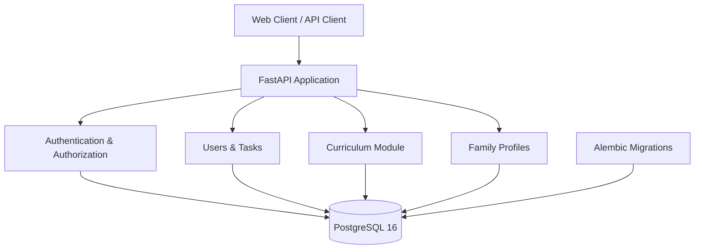

# Backend API

A containerized REST API for authentication, task management, educational curriculum, and parent–student profiles.

<p align="center">
  <a href="https://github.com/AMAN-AJWA-FATIMA/Backend/actions/workflows/ci.yml"></a>
  
  
  
  
</p>

---

## Contents

- [Overview](#overview)
- [Features](#features)
- [Architecture](#architecture)
- [Technology stack](#technology-stack)
- [Getting started](#getting-started)
- [Configuration](#configuration)
- [API reference](#api-reference)
- [Database and migrations](#database-and-migrations)
- [Administrator setup](#administrator-setup)
- [Testing](#testing)
- [Security](#security)
- [Project structure](#project-structure)

---

## Overview

The project provides a backend foundation combining account authentication, role-based access control, task operations, educational curriculum management, and family profile relationships.

The API is built with FastAPI and uses PostgreSQL for persistent storage. Docker Compose provides the application and database services, while Alembic manages database schema migrations.

## Features

| Module | Capabilities |
|---|---|
| Authentication | Registration, login, access tokens, refresh, logout |
| Authorization | Role-based access control for students, parents, and administrators |
| Users | User creation, retrieval, listing, and deletion |
| Tasks | Task creation, retrieval, filtering, updating, and deletion |
| Curriculum | Grades, subjects, books, chapters, pages, and topics |
| Family | Student and parent profiles, invitation codes, linking, and consent |
| API documentation | OpenAPI, Swagger UI, and ReDoc |
| Development | Docker Compose, Alembic, Ruff, Pytest, GitHub Actions |

## Architecture



## Technology stack

| Technology | Purpose |
|---|---|
| Python 3.12 | Backend runtime |
| FastAPI | REST API framework |
| Pydantic | Request and response validation |
| SQLAlchemy 2.x | ORM and database interaction |
| PostgreSQL 16 | Relational database |
| Alembic | Schema migration management |
| PyJWT | JWT handling |
| Argon2 | Password hashing |
| Docker Compose | Local container orchestration |
| Pytest | Automated testing |
| Ruff | Linting |
| GitHub Actions | Continuous integration |

---

## Getting started

### Prerequisites

- Git
- Docker
- Docker Compose
- Python 3.12 (for local development)

### 1. Clone the repository

```bash
git clone https://github.com/AMAN-AJWA-FATIMA/Backend.git
cd Backend
```

### 2. Configure environment variables

Create a local environment file:

```bash
cp .env.example .env
```

Edit `.env` and replace the placeholder credentials and secret values before starting the application.

### 3. Start the application

```bash
docker compose up --build
```

Docker Compose starts the API and PostgreSQL services. The API container runs database migrations before launching the application.

### 4. Access the application

| Resource | URL |
|---|---|
| Web interface | http://localhost:8000/ |
| API health | http://localhost:8000/health |
| Swagger UI | http://localhost:8000/docs |
| ReDoc | http://localhost:8000/redoc |
| OpenAPI schema | http://localhost:8000/openapi.json |

Health endpoint response:

```json
{
  "status": "healthy"
}
```

### Stop the services

```bash
docker compose down
```

To remove the database volume as well (this permanently deletes its persisted database data):

```bash
docker compose down -v
```

---

## Configuration

The application reads settings from `.env`.

| Variable | Description |
|---|---|
| `POSTGRES_USER` | PostgreSQL container user |
| `POSTGRES_PASSWORD` | PostgreSQL container password |
| `POSTGRES_DB` | PostgreSQL container database |
| `DB_HOST` | Database hostname |
| `DB_PORT` | Database port |
| `DB_NAME` | Application database name |
| `DB_USER` | Application database user |
| `DB_PASSWORD` | Application database password |
| `JWT_SECRET_KEY` | Secret used for JWT signing |
| `ACCESS_TOKEN_EXPIRE_MINUTES` | Access token lifetime |
| `REFRESH_TOKEN_EXPIRE_DAYS` | Refresh token lifetime |

The Compose configuration exposes PostgreSQL on host port `5433` and uses port `5432` inside the container network.

> Keep `.env` out of version control. Use strong, unique secrets and passwords.

---

## API reference

All routes are documented interactively through Swagger UI at `/docs`.

<details>
<summary><strong>Authentication</strong></summary>

| Method | Endpoint | Description |
|---|---|---|
| POST | `/auth/register` | Register a public student account |
| POST | `/auth/login` | Authenticate and obtain tokens |
| POST | `/auth/refresh` | Refresh tokens |
| POST | `/auth/logout` | Revoke refresh token |
| GET | `/auth/me` | Get current authenticated user |

</details>

<details>
<summary><strong>Users</strong></summary>

| Method | Endpoint | Description |
|---|---|---|
| POST | `/users/` | Create user |
| GET | `/users/` | List users |
| GET | `/users/{user_id}` | Retrieve user |
| DELETE | `/users/{user_id}` | Delete user |

</details>

<details>
<summary><strong>Tasks</strong></summary>

| Method | Endpoint | Description |
|---|---|---|
| POST | `/tasks/` | Create task |
| GET | `/tasks/` | List tasks with filtering |
| GET | `/tasks/{task_id}` | Retrieve task |
| PATCH | `/tasks/{task_id}` | Update task |
| DELETE | `/tasks/{task_id}` | Delete task |

</details>

<details>
<summary><strong>Curriculum — Public Read Operations</strong></summary>

| Method | Endpoint | Description |
|---|---|---|
| GET | `/curriculum/grades` | List grades |
| GET | `/curriculum/grades/{grade_id}/subjects` | List subjects for a grade |
| GET | `/curriculum/subjects/{subject_id}/books` | List books for a subject |
| GET | `/curriculum/books/{book_id}/chapters` | List book chapters |
| GET | `/curriculum/chapters/{chapter_id}/pages` | List chapter pages |

</details>

<details>
<summary><strong>Curriculum — Administrator Operations</strong></summary>

| Method | Endpoint | Description |
|---|---|---|
| POST | `/curriculum/admin/{resource}` | Create curriculum record |
| PATCH | `/curriculum/admin/{resource}/{record_id}` | Update curriculum record |
| DELETE | `/curriculum/admin/{resource}/{record_id}` | Delete curriculum record |

Supported resources include grades, subjects, books, chapters, pages, and topics.

</details>

<details>
<summary><strong>Student Profiles</strong></summary>

| Method | Endpoint | Description |
|---|---|---|
| POST | `/profiles/student` | Create student profile |
| GET | `/profiles/student/me` | Retrieve own profile |
| PATCH | `/profiles/student/me` | Update own profile |
| POST | `/family/invites` | Generate parent invitation code |

</details>

<details>
<summary><strong>Parent Profiles & Family Linking</strong></summary>

| Method | Endpoint | Description |
|---|---|---|
| POST | `/profiles/parent` | Create parent profile |
| GET | `/profiles/parent/me` | Retrieve own profile |
| PATCH | `/profiles/parent/me` | Update own profile |
| POST | `/family/link` | Link student using invitation code |
| GET | `/family/children` | List linked children |
| GET | `/family/children/{student_id}` | Retrieve linked student |
| POST | `/family/children/{student_id}/consent` | Record parental consent |

</details>

<details>
<summary><strong>Role-Based Access Demonstration</strong></summary>

| Method | Endpoint | Description |
|---|---|---|
| GET | `/admin/dashboard` | Administrator-only endpoint |
| GET | `/parent/dashboard` | Parent/admin endpoint |

</details>

---

## Database and migrations

The application uses PostgreSQL with SQLAlchemy models and Alembic migrations.

### Apply migrations

Inside the running API container:

```bash
docker compose exec api alembic upgrade head
```

### Migration commands

```bash
# View current revision
docker compose exec api alembic current

# View migration history
docker compose exec api alembic history

# Generate a migration
alembic revision --autogenerate -m "describe schema change"

# Apply migrations
alembic upgrade head
```

Schema changes should be managed through migrations rather than manually modifying production database tables.

---

## Administrator setup

Public registration is restricted to student accounts. Administrator accounts are provisioned using the local CLI script.

Run the script in the API container:

```bash
docker compose exec api python scripts/create_admin.py
```

The script prompts for administrator name, email, password, and confirmation. It requires a password of at least 12 characters.

## Curriculum seed data

A seed script is available for development:

```bash
docker compose exec api python scripts/seed_curriculum.py
```

It creates sample grades, subjects, books, and chapters using get-or-create operations.

---

## Testing

Run the test suite in your local Python environment:

```bash
pytest -v
```

Run Ruff:

```bash
ruff check .
```

Check Docker Compose configuration:

```bash
docker compose config -q
```

The test suite covers authentication, authorization, user management, task operations, curriculum behavior, family linking, and health checks.

## Continuous integration

GitHub Actions runs the following checks on pushes and pull requests targeting `main`:

| Job | Check |
|---|---|
| Ruff Linting | `ruff check .` |
| Pytest | `pytest -v` |

Workflow configuration:

`.github/workflows/ci.yml`

---

## Security

- Passwords are hashed using Argon2.
- JWT-based access tokens are used for authentication.
- Refresh tokens are rotated and revocable.
- Role-based dependencies restrict protected operations.
- Parent–student access is controlled through family-link relationships.
- Database credentials and signing secrets are configured through environment variables.
- Public registration cannot assign administrator or parent roles.

This project is intended for development and learning. Review configuration, deployment, secret management, and security requirements before using it in a production environment.

---

## Project structure

```text
Backend/
├── app/
│   ├── core/             # Configuration, database, security
│   ├── dependencies/     # Authentication and permissions
│   ├── models/           # SQLAlchemy models
│   ├── routers/          # API endpoints
│   ├── schemas/          # Pydantic schemas
│   └── main.py           # FastAPI application
├── alembic/
│   └── versions/          # Database migrations
├── docker/
│   └── postgres/          # Database initialization
├── scripts/               # Admin and seed utilities
├── tests/                 # Automated tests
├── web/                   # Web interface
├── .github/workflows/     # CI workflows
├── Dockerfile
├── docker-compose.yml
├── requirements.txt
└── README.md
```

---

<p align="center">
  <sub>Built with FastAPI, PostgreSQL, and Python.</sub>
</p>

